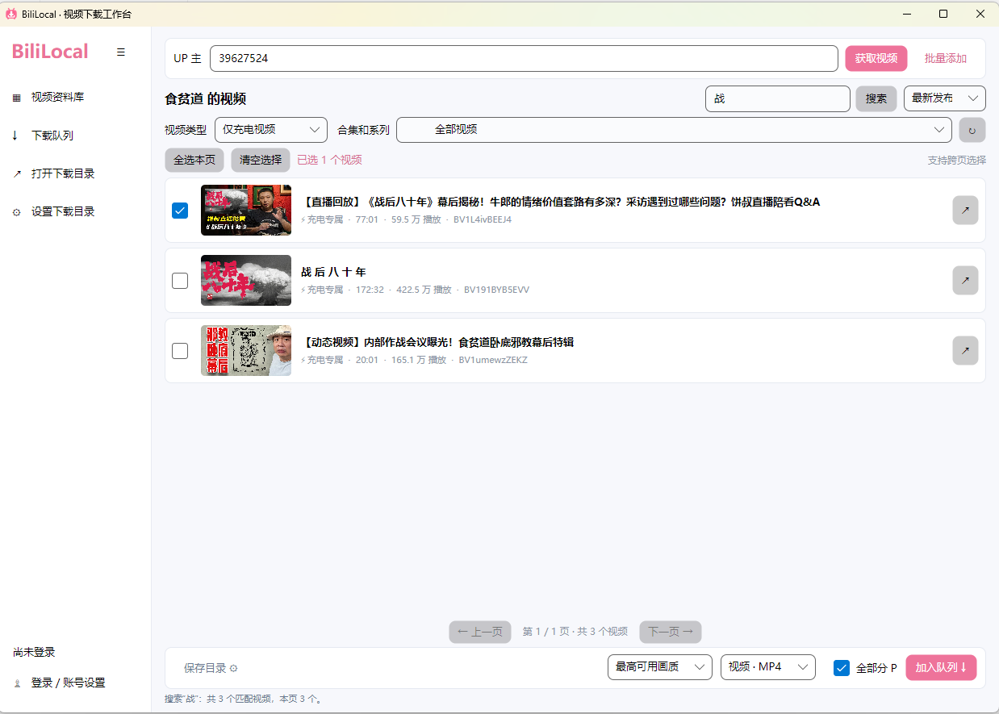

# BiliLocal

简洁的 B 站批量视频下载工具，基于 .NET 8 + Avalonia，适用于 Windows x64。

[下载最新版](https://github.com/cnbright/BiliLocal/releases/latest)



## 功能

- Cookie、扫码及官方浏览器账号登录。
- 按 UP 主获取视频，支持关键词搜索、充电视频筛选、合集和系列选择。
- 跨页多选、批量添加链接，下载 MP4 视频或 MP3 音频，支持分 P 单选、多选或全部下载。
- 自定义保存目录，成品直接保存为 `视频名称.mp4` 或 `视频名称 - 分P名称.mp4`。
- 支持 1–6 个任务并行下载、暂停续传，以及全部开始、全部暂停和全部删除。
- 内置 FFmpeg，侧栏可收起。

## 使用

1. 从 [Releases](https://github.com/cnbright/BiliLocal/releases/latest) 下载 `BiliLocal.exe`，双击运行，无须另装 .NET 或 FFmpeg。
2. 按需登录账号，输入 UP 主 UID 或空间链接，点击“获取视频”。
3. 搜索、筛选并勾选视频，设置保存目录、画质和格式，加入下载队列。

下载指定分 P 时，点击视频右侧“选分 P”，勾选一个或多个分 P 后确认。也可以先选择多个视频，将底部下载范围设为“选择分 P…”，再点击“加入队列”统一选择。弹窗支持全选和清空选择，任务会保存所选分 P 以便暂停续传。

**未登录时连续搜索容易触发 B 站请求限制，建议登录后使用。受限后请等待一段时间再试，避免频繁重复搜索。**

账号登录需要本机安装 Edge 或 Chrome；Cookie 仅保存在内存，退出后需重新登录。可下载内容和画质取决于账号实际权限，请仅下载自己有权保存的内容。

## 源码运行

安装 .NET 8 SDK，在 Windows PowerShell 中执行：

```powershell
.\setup-ffmpeg.ps1
dotnet run --project BiliLocal.Desktop
```

测试：`dotnet test BiliLocal.Tests -c Release`。打包：`.\publish.ps1 -SingleFile`，输出为 `dist/BiliLocal.exe`。

项目结构、依赖来源和数据目录见 [开发说明](docs/development.md)。
